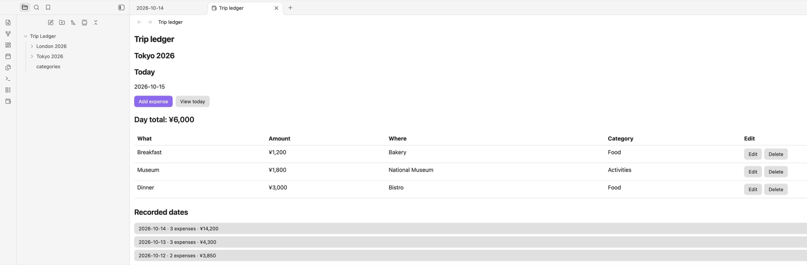
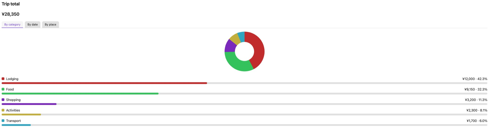

# Trip Ledger

[English](README.md) | 한국어

Obsidian에서 여행별 지출을 날짜별로 기록하고, 종류와 사용처별 합계를 확인하는 플러그인입니다. 한국어가 기본 언어이며 영어 UI도 제공합니다.

## 스크린샷

### 대시보드



### 통계



스크린샷은 예시 여행에서 영어 인터페이스로 촬영했습니다.

## 사용법

1. **설정 → Trip Ledger → 현재 여행**에서 **여행 만들기**를 선택하고 이름과 통화 코드를 입력합니다. 새 여행은 별도 폴더에 생성되고 현재 여행으로 저장됩니다.
2. 명령 팔레트에서 **여행 지출 열기**를 실행하거나 왼쪽 리본의 지갑 아이콘을 선택하면 현재 여행의 대시보드가 열립니다. 여기서 오늘 지출과 기록된 날짜를 볼 수 있습니다. 처음 설치해 아직 여행이 없으면 **설정에서 여행을 생성하세요**라는 안내가 표시됩니다.
3. 대시보드의 **지출 추가**에서 오늘 지출의 무엇을, 금액, 사용처, 종류를 입력합니다. 기록된 날짜를 선택하거나 날짜 선택기로 다른 날짜를 열면 해당 날짜의 지출을 추가할 수 있습니다. **대시보드로 돌아가기**를 선택하면 다시 목록으로 이동합니다. 두 화면의 표에서 지출을 수정하거나 삭제할 수 있습니다.
4. **통계 보기**에서 여행 전체 합계를 확인하고, **종류별 지출**의 비율 그래프, **날짜별 지출**의 날짜 합계, **사용처별 지출**의 장소별 금액을 탭으로 전환해 봅니다.
5. 날짜 상세 화면에서 **날짜 노트 열기**를 선택하면 해당 날짜의 Markdown 파일을 Obsidian에서 열 수 있습니다. **여행 지출 열기**를 다시 실행하면 대시보드로 돌아갑니다.

지난 여행을 다시 편집하려면 **설정 → Trip Ledger → 여행 폴더 선택**에서 그 폴더를 선택합니다. 선택 목록은 설정된 장부 폴더의 직계 하위 폴더만 읽습니다. 각 폴더의 `trip.md`가 올바른 여행 파일인지 확인하며, 그렇지 않은 폴더를 선택하면 **여행 설정되지 않는 디렉토리 입니다.**라는 안내가 표시되고 기존 선택이 유지됩니다. 같은 장소에 다시 가더라도 새 여행을 만들면 기록이 섞이지 않습니다. Obsidian을 다시 열면 저장된 현재 여행을 복원합니다. 해당 여행이 없어졌다면 설정에서 다시 선택하거나 새로 만듭니다.

종류 선택창의 **종류 추가**에서 새 종류를 만들 수 있습니다. 추가한 종류는 현재 장부의 모든 여행에서 사용할 수 있습니다. **설정 → Trip Ledger**에서 사용자 종류의 이름을 바꾸거나 숨기고 다시 표시할 수 있습니다. 숨긴 종류도 기존 기록과 통계에는 남습니다. 같은 설정 화면에서 한국어와 영어를 전환할 수 있습니다.

**설정 → Trip Ledger → 장부 폴더**에서 볼트 최상위 폴더 이름을 입력하고 **폴더 설정**을 선택합니다. 대상 폴더가 없으면 기존 장부 폴더를 새 이름으로 이동하고, 기존 장부 폴더도 없으면 이름만 저장했다가 첫 기록을 만들 때 생성합니다. 대상 폴더가 있으면 파일을 이동·수정·병합하지 않고 연결합니다. 유효한 여행이 있는 폴더, 여행 메타데이터 없이 올바른 `categories.md`가 있는 폴더, 장부 메타데이터 없이 다른 내용만 있는 폴더를 사용할 수 있으며 기존 내용은 유지됩니다. `categories.md`가 잘못되었거나 유효한 여행 없이 `trip.md` 메타데이터가 잘못되거나 중복되었다면 오류가 표시됩니다. 확인할 때는 `categories.md`와 직계 여행 폴더의 `trip.md`만 읽고 날짜 파일은 검사하지 않습니다.

**설정 → Trip Ledger → 기존 장부 선택** 목록도 계속 사용할 수 있습니다. 볼트 최상위 폴더 중 유효한 여행 `trip.md`가 하나 이상 있는 장부만 표시하며, 플러그인 밖에서 이름을 바꾼 장부도 다시 연결할 수 있습니다. 유효한 여행이 있는 장부를 연결하면 저장된 여행 ID가 유효한 여행 하나와 정확히 일치할 때만 선택을 유지합니다. 저장된 ID가 없을 때 유효한 여행이 하나뿐이면 자동 선택하고, 여러 개면 **여행 폴더 선택**에서 직접 선택합니다. 저장된 ID와 일치하는 유효한 여행이 없거나 둘 이상이면 선택을 지우므로, 유효한 여행이 하나뿐이어도 **여행 폴더 선택**에서 직접 선택해야 합니다. Obsidian을 다시 열 때는 저장된 장부 경로를 사용합니다.

## 저장 방식

모든 기록은 볼트 최상위의 장부 폴더에 저장되며 기본 이름은 `Trip Ledger/`입니다. 새 여행은 이름으로 된 폴더에 저장합니다. 같은 폴더명이 이미 있으면 새 폴더명 뒤에 짧은 고유 ID를 붙입니다. 기존에 고유 ID가 붙은 폴더만 있다면 이름으로 된 폴더를 새로 사용할 수 있습니다. 각 여행은 날짜마다 `dates/YYYY-MM-DD.md` 파일을 사용합니다. `trip.md`에는 여행 이름과 통화가, 장부 폴더의 `categories.md`에는 사용자 종류가 저장됩니다. 날짜 파일의 frontmatter에는 지출 데이터가 들어가고 본문은 자유롭게 메모할 수 있습니다. 플러그인은 본문을 덮어쓰지 않습니다.

한 여행에는 한 통화를 사용합니다. 첫 지출을 기록한 뒤에는 통화를 변경할 수 없습니다. 지출을 모두 삭제해도 통화 잠금은 유지됩니다. 환율 조회나 통화 환산, 여행 간 금액 합산은 제공하지 않습니다.

플러그인은 네트워크 요청이나 사용 통계 수집을 하지 않습니다. 기록을 읽고 수정하는 범위는 현재 장부 폴더 안의 플러그인 관리 파일로 제한됩니다. **기존 장부 선택** 목록을 만들 때는 볼트 최상위 폴더와 그 바로 아래 여행 폴더를 확인하고, 후보의 `trip.md`와 `categories.md`만 읽습니다. 현재 여행 ID와 장부 폴더 이름은 플러그인 설정에 저장됩니다.

## 개발 및 설치

Node.js 18 이상과 npm을 사용합니다.

```bash
npm install
npm test
npm run build
npm run lint
```

빌드된 `main.js`, `manifest.json`, `styles.css`를 볼트의 `.obsidian/plugins/trip-ledger/`에 두고 **설정 → 커뮤니티 플러그인**에서 활성화합니다. 이 저장소를 해당 플러그인 폴더에서 개발한다면 빌드 후 Obsidian을 다시 로드하면 됩니다.

`main.js`와 `node_modules/`는 생성 산출물이므로 Git에 추가하지 않습니다.

## 라이선스

Trip Ledger는 Zero-Clause BSD(0BSD) 라이선스로 배포됩니다. 자세한 내용은 [LICENSE](LICENSE)를 확인하세요.
